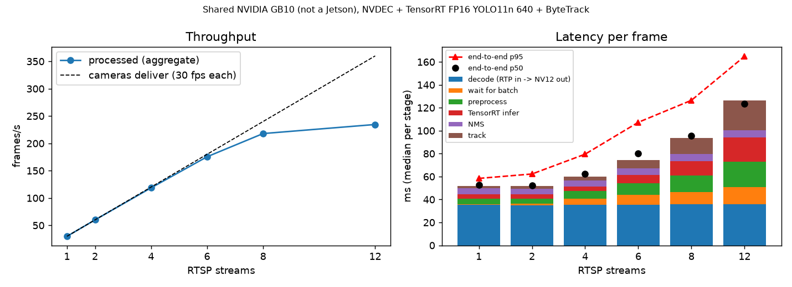

# multistream-trt-pipeline

Several RTSP cameras in, tracked detections out, on one GPU. The pipeline does GStreamer decode, one batched TensorRT FP16 YOLO11n call across all streams, and one ByteTrack instance per stream. The main output is the benchmark: per-stage latency, end-to-end latency and aggregate FPS for N = 1 ... 12 streams, measured over the real RTSP path (not files).


(4 streams of MOT17 pedestrian clips, low-res mosaic, head regions blurred.)

## Architecture

```
mediamtx (local RTSP server)          one per camera
  ^ ffmpeg -re -c copy  <- 1080p30 H.264 clips (MOT17)
  |
rtspsrc -> rtph264depay -> h264parse -> nvh264dec (NVDEC) -> NV12 appsink   [source.py, 1 thread/stream, keeps newest frame]
                                              |
                  take newest frame of every stream (batch = whatever is ready, <= 16)
                                              |
  H2D copy NV12 -> resize+YUV->RGB+letterbox on GPU -> TensorRT FP16 (dynamic batch) -> top-k + NMS   [engine.py, pipeline.py]
                                              |
                      per-stream ByteTrack (CPU worker thread, overlaps next batch)   [pipeline.py]
```

Cameras are modelled as sources that never wait. If inference is slower than the cameras, old frames are dropped (newest-frame-wins), so latency stays bounded and the drop rate shows saturation.

## Results

The GPU is a shared NVIDIA GB10 (aarch64, desktop-class Blackwell GPU), not a Jetson. The machine has 20 CPU cores, TensorRT 10.16 and GStreamer 1.24. The GPU was already about 88% utilised by other jobs before the pipeline started (`gpu_util_before_pct` in `results/bench.json`), so absolute numbers are noisy and only comparable relative to each other. Sources are 1080p30 H.264, the model is YOLO11n 640x640 FP16, person class, conf 0.25. Each point runs 30 s after a 6 s warm-up, once, with no repeats, so treat differences of a few ms as noise.

Latency is in ms, median / p95. Batch stages are per batch, not per frame. End-to-end runs from the moment an H.264 access unit reaches the pipeline (after RTSP/RTP depayload) until that frame's tracks are computed. It does not include camera exposure, camera encoding, or the network.

| Streams | Decoder | Agg. FPS | Dropped | Mean batch | Decode | Wait for batch | Preproc | Infer | NMS | Track | **End-to-end** | CPU cores (proc) |
|---|---|---|---|---|---|---|---|---|---|---|---|---|
| 1 | NVDEC | 30 | 0.2% | 1.0 | 35.2 / 37.6 | 0.7 / 2.2 | 4.9 / 7.1 | 3.6 / 5.0 | 5.5 / 8.0 | 1.8 / 3.7 | **52.8 / 58.4** | 0.6 |
| 2 | NVDEC | 60 | 0.1% | 1.0 | 35.1 / 37.9 | 1.1 / 8.6 | 4.6 / 7.2 | 3.5 / 4.0 | 5.1 / 6.0 | 2.3 / 4.3 | **52.2 / 62.2** | 1.1 |
| 4 | NVDEC | 119 | 1.2% | 1.9 | 35.2 / 37.8 | 5.3 / 17.2 | 6.8 / 11.3 | 3.9 / 7.3 | 5.2 / 6.2 | 3.4 / 8.2 | **62.5 / 79.5** | 1.5 |
| 6 | NVDEC | 175 | 10.0% | 4.0 | 35.4 / 38.3 | 8.8 / 24.8 | 9.9 / 18.1 | 7.2 / 12.1 | 5.7 / 8.0 | 7.4 / 17.5 | **80.0 / 107.3** | 1.9 |
| 8 | NVDEC | 218 | 20.1% | 7.1 | 35.8 / 39.0 | 10.8 / 27.0 | 14.2 / 26.9 | 12.7 / 14.6 | 6.1 / 8.9 | 14.3 / 29.0 | **95.4 / 126.5** | 2.4 |
| 12 | NVDEC | 235 | 51.5% | 11.8 | 35.8 / 39.3 | 15.0 / 30.1 | 22.0 / 34.6 | 21.3 / 24.0 | 6.5 / 12.5 | 25.7 / 47.8 | **123.7 / 164.9** | 3.1 |
| 4 | CPU (libav) | 119 | 1.0% | 1.8 | 7.8 / 12.7 | 6.5 / 15.4 | 6.5 / 9.5 | 3.8 / 7.1 | 5.0 / 5.7 | 3.0 / 7.2 | **34.7 / 49.0** | 2.2 |
| 8 | CPU (libav) | 231 | 15.9% | 6.5 | 8.3 / 13.0 | 10.4 / 27.8 | 12.9 / 19.9 | 11.2 / 13.3 | 5.6 / 7.0 | 10.9 / 24.0 | **61.2 / 90.4** | 3.8 |

Raw data: `results/bench.json`, `results/bench.csv`. Plot:



What the numbers show:

- Real-time (all 30 fps of every camera processed) holds up to 4 streams. At 6 streams about 10% of frames are dropped, and throughput flattens around 220-235 fps from 8 streams on. The cap is not one stage: preprocessing, inference and tracking all grow with batch size, on a GPU that other jobs are also using.
- NVDEC decode takes about 35 ms against about 8 ms for CPU decode. That is the time from H.264 data entering the decoder to the frame reaching the appsink. I did not investigate the cause. My guess, unverified, is decoder output buffering or reordering delay in `nvh264dec` + `cudadownload`. At 1080p30 with up to 8 streams the CPU decoder at one thread per stream was fine and gave lower end-to-end latency. NVDEC's advantage here would be CPU load, which stays low either way (under 4 cores for the whole process). On a CPU-limited edge box the trade-off could flip. Both are measured and neither is tuned.
- Tracking costs about 1-2 ms per frame on CPU but is serialised on one worker thread, so it becomes the largest stage at 12 streams.
- GPU utilisation is not informative here. It reads 92-95% in every run because the GPU was already busy before the pipeline started. Per-stage times are the usable signal. CPU is the `psutil` CPU time of this process (cores used, decode threads included).
- Per-stage times are taken with a CUDA sync after each stage, which costs a little throughput compared with an unsynchronised pipeline.

## Mapping to Jetson Orin

This is an approach, not measured.

- Rebuild the engine on the device. `build_engine.py` works unchanged apart from paths, because engines are not portable across GPU architectures or TensorRT versions.
- Swap `nvh264dec ! cudadownload` for `nvv4l2decoder` (NVDEC via V4L2) and keep the frames in NVMM memory, with `nvvidconv`/VIC doing resize and colour conversion instead of the torch kernels in `preprocess_nv12`. That frees the GPU for inference.
- Lock clocks (`nvpmodel`, `jetson_clocks`), then re-run `bench.py`. I expect the saturation point at fewer streams than here, and the per-stage breakdown shows where to spend effort.
- Consider DLA for the detector, and INT8 with calibration frames from the real cameras (see `yolo-tensorrt-edge` for an INT8 experiment on this model).

## Reproduce

```bash
# system: python3-gi, GStreamer 1.24 with gst-plugins-bad (nvcodec) and gst-libav, ffmpeg with libx264
python3 -m venv --system-site-packages .venv && .venv/bin/pip install -r requirements.txt
MOT17=/path/to/MOT17/train scripts/prepare.sh      # clips, mediamtx binary, TensorRT engine
.venv/bin/python pipeline.py --streams 4 --seconds 30 --preview docs/preview.mp4   # one run
.venv/bin/python bench.py --streams 1 2 4 6 8 12 --seconds 30                        # sweep -> results/
.venv/bin/python plot.py
PYTEST_DISABLE_PLUGIN_AUTOLOAD=1 pytest -q tests   # letterbox, colour convert, NMS maths (CPU only)
```

Use `--urls rtsp://... rtsp://...` to point the pipeline at real cameras.

## Limitations

- The "cameras" are a local mediamtx re-publishing a few looping MOT17 clips (`ffmpeg -c copy`). There is no network jitter, no packet loss, and the GOP structure is identical. Several streams share the same 4 clips (offset in time), so streams are not fully independent content.
- The clips are pedestrian footage encoded from MOT17 JPEG frames, not real camera footage. There is no accuracy evaluation here. Detector quality is whatever YOLO11n gives (see `object-tracking-bench` for tracking metrics on MOT17).
- The GPU is shared and each point is a single run, with no repeats or confidence intervals.
- Latency excludes everything before the RTP packet arrives. Input is H.264 only. Frame size changes mid-stream and padded NV12 strides raise an error rather than being handled.
- The input is fixed at 640, so small people in 1080p scenes are missed more than at higher resolution.

## License

MIT for the code. MOT17 is CC BY-NC-SA 3.0 (non-commercial), and the clips are not included in the repo. YOLO11 weights are AGPL-3.0 (Ultralytics). Author: Ha Phan Thanh Hai.
